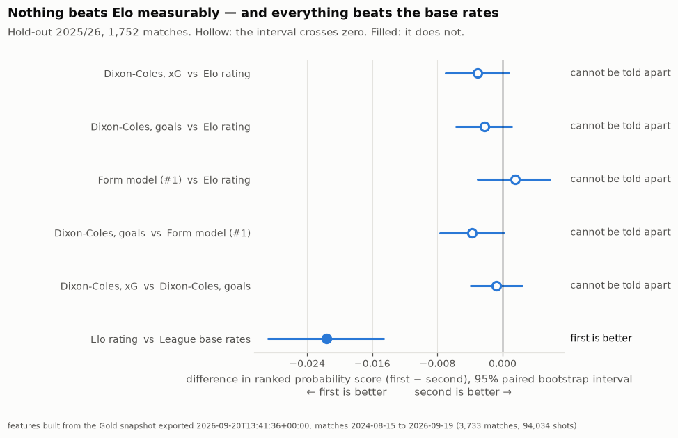
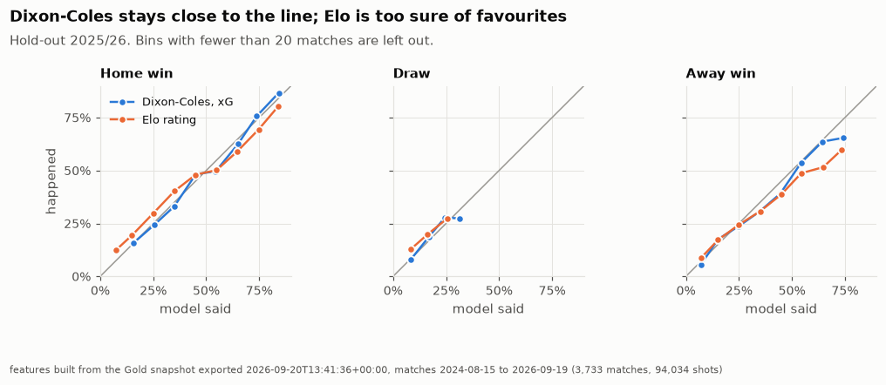
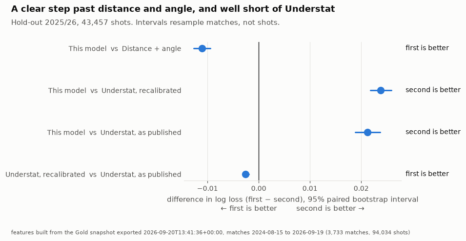
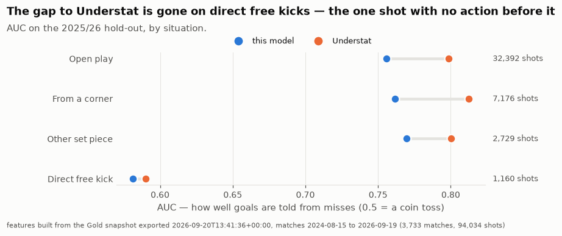
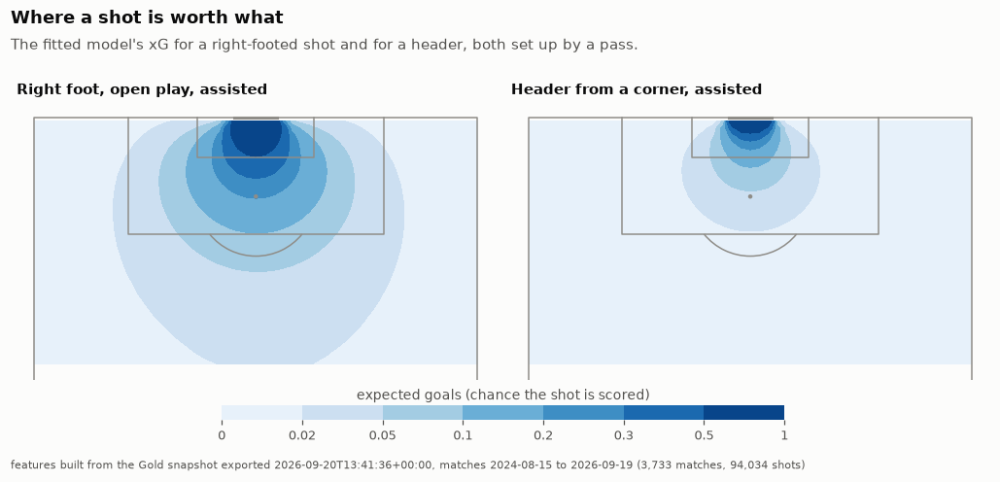
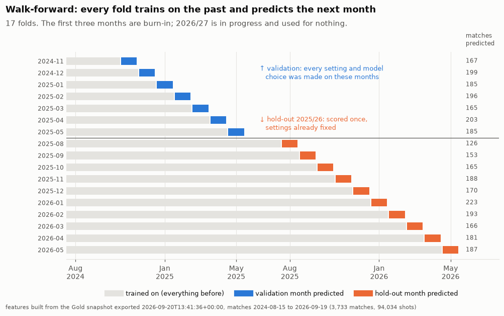

# Football ML — what a model can predict, and what it can't

[](https://github.com/Fabiohhp/football-data-science/actions/workflows/ci.yml)

**Match-result and expected-goals models for the big-5 European leagues, scored on a
season they never saw, against honest baselines, with every comparison carrying an
interval — and the tests that make the scores believable.**

This is Part 3, the closing chapter, of a three-part portfolio. Part 1 built the
pipeline, Part 2 turned it into answered questions, and this part asks the predictive
version of those questions.

| Part | Scope | Repository |
|------|-------|------------|
| 1 — Data Engineering | Ingestion, Airflow, Bronze/Silver/Gold, data quality | [`football-data-engineering`](https://github.com/Fabiohhp/football-data-engineering) |
| 2 — Analytics & BI | Metrics layer, analyses, dashboard | [`football-data-analytics`](https://github.com/Fabiohhp/football-data-analytics) |
| **3 — Machine Learning** | **Match outcome and xG models, evaluation** | **this repository** |

**You do not need to run anything to read this, and you need only this repository to
reproduce it.** Every number below comes from a committed report in [`reports/`](reports),
every chart from a committed notebook, and [`part2_snapshot/`](part2_snapshot) holds the real
data they were built from. CI also runs the whole pipeline on synthetic data.

---

## The findings

### 1. Nothing forecasts match results measurably better than an Elo rating — but the goals models are calibrated

Five methods gave a probability to home win, draw and away win before every match of
2025/26:

- league base rates;
- an Elo rating;
- a form model (last five matches: points, goals, non-penalty xG, xPTS);
- Dixon-Coles predicting each side's goals, fitted to goals;
- the same model, fitted to xG.

Settings were chosen on 2024/25, then 2025/26 was scored once.

> **Dixon-Coles on xG scores best, and still cannot be told apart from Elo.** Ranked
> probability score (lower is better):
>
> | | RPS |
> |---|---|
> | Dixon-Coles, xG | **0.2045** |
> | Dixon-Coles, goals | 0.2054 |
> | Elo rating | 0.2076 |
> | Form model | 0.2091 |
> | League base rates | 0.2293 |
>
> Against Elo, the difference is −0.0031, with a 95% interval from −0.0070 to
> +0.0008, which crosses zero. Elo and the form model beat the league base rates with
> intervals well clear of zero, and the Dixon-Coles models score better still.



The models differ in calibration rather than in score. Elo is too sure of favourites:
an away win it gave 65% happened 52% of the time. Dixon-Coles stays close to the diagonal.



Part 2 found that xG difference carries information that points do not. As a
forecaster, that shows up here as the best point estimate, by less than one season can
measure. Modelling **goals** beats modelling the **result** on log loss (−0.0185,
interval −0.0331 to −0.0039). Fitting to xG instead of goals led clearly on validation,
but could not be told apart from goals on the hold-out.

→ [`notebooks/01_match_outcome.ipynb`](notebooks/01_match_outcome.ipynb)

### 2. An xG model built from what the warehouse carries beats distance and angle, and falls short of Understat where the missing data says it should

The model sees a shot's location (distance and angle to goal), the situation, the body
part, whether a pass set it up, home or away, and the minute. Penalties and own goals
are excluded. Understat's published xG is the benchmark and never an input.

> **A clear step past the distance-and-angle baseline** (log loss −0.011, interval
> −0.0127 to −0.0095), **and well short of Understat** (+0.024, interval +0.0218 to
> +0.0259). The gap is in telling goals from misses: AUC 0.757 against 0.799.
> Calibration is not the problem.



The gap is not spread evenly. It is largest in open play and from corners, and
**vanishes on direct free kicks**, the one shot with no action before it. The warehouse
does not carry the action before a shot (a cross, a through ball, a rebound), which
Understat's model uses. The pattern is consistent with that being the missing piece. It
is not proof: there is no interval per situation, and only 1,160 free kicks.



What the model learned, drawn from its own predictions:



Understat's own xG runs high on these seasons: 0.115 per shot against 0.099 scored.
The headline comparison is therefore against Understat **recalibrated** on each
training fold. That way the model gets no credit for calibration it would get for free.

→ [`notebooks/02_shot_xg.ipynb`](notebooks/02_shot_xg.ipynb)

---

## Why these numbers can be trusted

A model that has seen the future scores well in evaluation and badly in use, and the
failure looks like success. Most of this repository exists to rule that out, with tests
rather than care.

**The split only ever runs forward.** Every fold trains on all matches strictly before a
month and predicts that month. Settings were chosen on the blue months; the orange
months were scored once, with everything fixed. For shots, a match is never split
between training and test.



**Every feature is tested for leakage, and the tests are tested.** Each feature row
records the latest date it read, and a dbt test fails any row that read its own match
date or later. The test suite then plants leaks on purpose and asserts that the right
test fails, by name:

- a rolling window that includes the match itself;
- a season summary joined on the current season;
- a feature model added without the leakage test;
- a feature for the home side with no away twin;
- a shot's outcome slipped in as a column;
- penalties let in;
- own goals let in.

**The hold-out was looked at once, and the reports say so.** Every method's hold-out
score carries a ledger entry keyed by a fingerprint of its settings, features and folds.
Re-running reproduces the entry; changing anything and re-scoring would add a second.

**Every comparison is paired and carries an interval.** It's a seeded bootstrap over
matches; for shots, over matches rather than shots, because shots in one match are not
independent. "Better" means the whole 95% interval is on one side of zero.

**Every model has its baseline in the same report**: base rates and Elo for results,
distance and angle (and Understat) for shots.

Some of what those tests caught while this was built:

- **A leakage test that never ran.** Planting a leak failed the build, but on a
  different test. `dbt build` skips everything downstream of a failure, so the leakage
  test itself had been skipped. It is now attached to each feature model separately,
  with a guard that none can lack it.
- **Two tests that checked nothing.** They looked up their table by name rather than
  through dbt's `ref()`, so they ran *before* the model was built and passed on an
  empty database.
- **A citation three hours out.** A timestamp lost its time-zone offset when read from
  JSON. It was wrong on a laptop in UTC−3 and right in CI, which runs in UTC.
- **A promoted club given the wrong starting strength.** Club strength was ranked by
  attack *minus* defence instead of plus, which calls a strong defensive side weak.

---

## What the models can and cannot do

**They can:**

- give well-calibrated probabilities for home win, draw and away win. When a Dixon-Coles
  model says 60%, it happens close to 60% of the time;
- rank shots by their chance of going in, from the information a warehouse of match
  events carries.

**They cannot:**

- **Beat an Elo rating measurably** on one season of matches. The differences, around
  0.002–0.003 RPS, are below what 1,752 matches can resolve. "Cannot be told apart" is
  not "equal".
- **Call draws.** A quarter of matches are draws; no model makes a draw the most likely
  result in more than a few percent of them.
- **Claim anything about the betting market.** The warehouse holds no odds, so the only
  comparisons are with the baselines shown.
- **See what came before a shot**, so an xG model from this data stays below Understat's.
- **Say why a team wins.** What a model uses is not what causes results; nothing here
  reads importances causally.

**And the data has limits:** history starts in August 2024, so every club's rating and
form is younger than its real record. Two complete seasons are a small dataset for
machine learning, which is why every model here has few parameters, and why histogram
boosting lost to logistic regression each time it was tried.

---

## How it is built

```
Part 2's metrics layer (analytics.duckdb)
    │  attached READ_ONLY; a column contract and a staleness check gate every build
    ▼
dbt features ─ point-in-time, one row per thing to predict, leakage-tested
    │
    ▼
src/football_ml ─ walk-forward splits, baselines, models, evaluation
    │
    ├─► reports/*.json   scores, intervals, calibration, the hold-out ledger
    ├─► models/*/        a model card per model: snapshot, training range, features, commit
    └─► notebooks/       one question each, reading the reports; nothing fitted there
```

| Concern | Choice | Why |
|---|---|---|
| Features | dbt + DuckDB | each feature has a stated grain and an as-of date, and a test can prove it never reads the future |
| Models | scikit-learn, statsmodels, a Dixon-Coles likelihood on `scipy.optimize` | a few thousand matches: few parameters, nothing deep |
| Evaluation | own `evaluate.py` | ranked probability score and paired/cluster bootstraps are not in scikit-learn; each is tested against hand-worked values |
| Experiment tracking | committed model cards and reports | a handful of models, readable on GitHub without a server |

---

## Running it

Needs only this repository: `dbt build` reads the real Part 2 tables in
[`part2_snapshot/`](part2_snapshot).

```bash
uv sync --extra dev

uv run dbt build --project-dir dbt --profiles-dir dbt    # features + leakage tests
uv run pytest -q                                         # incl. the planted leaks

uv run python -m football_ml.train match_outcome --validation-only   # choose, no hold-out
uv run python -m football_ml.train match_outcome         # score the hold-out, write reports
uv run python -m football_ml.train shot_xg

uv run jupyter lab                                       # the notebooks read reports/
uv run python scripts/export_readme_images.py            # the README's charts, from them
```

To build on Part 2 itself, with both repositories side by side:

```bash
(cd ../football-data-analytics && uv run dbt build --project-dir dbt --profiles-dir dbt)
PART2_DIR=../football-data-analytics uv run dbt build --project-dir dbt --profiles-dir dbt
```

Without real data, CI's way: generate a synthetic Part 2 and point the build at it.

```bash
uv run python tests/synthetic_part2.py /tmp/part2
PART2_DIR=/tmp/part2 uv run dbt build --project-dir dbt --profiles-dir dbt
```

## CI

Three jobs on GitHub Actions, on every push and pull request and once a week:

- **`build`** needs nothing outside this repository. CI generates a stand-in Part 2 from
  `contracts/part2_columns.json` with `tests/synthetic_part2.py`, the same generator the
  tests use, and runs lint, the tests and `dbt build`, with every leakage test, on it. Then
  it runs `dbt build` on `part2_snapshot/`, the real data a fresh clone builds on.
- **`part2-integration`** checks Part 2 out beside this repository and builds it on its own
  fixture, which carries traps the synthetic stand-in does not. This is how a Part 2 change
  that breaks this repository shows up.
- **`notebooks`** re-executes the notebooks against the committed reports, then checks that
  the README's charts are byte for byte the notebooks' figures.

## Repository map

```
contracts/part2_columns.json   every Part 2 column read, with its type
part2_snapshot/                the real Part 2 tables those columns come from
scripts/                       refresh that copy; lift the README's charts from the notebooks
dbt/models/sources/            src_* — thin selects over Part 2
dbt/models/features/           feat_team_form, feat_match_outcome, feat_shots
dbt/macros/, dbt/tests/        the leakage test, its coverage guard, grain and recomputation tests
src/football_ml/               splits, baselines, models/, evaluate, train, train_xg, viz
reports/                       match_outcome.json, shot_xg.json — the results
models/<name>/<version>/       model cards (binaries are rebuilt, not committed)
notebooks/                     01_match_outcome, 02_shot_xg
tests/                         unit tests, planted leaks, a synthetic Part 2 generator
```

## Data

Football data provided by the Football-Data.org API. Expected-goals, player and shot data come
from [Understat](https://understat.com/). The data belongs to its providers, under their terms,
and is not covered by this repository's MIT License.

## Author

Fábio Henrique Peixe ([LinkedIn](https://www.linkedin.com/in/f%C3%A1bio-henrique-peixe/)). Also by
the author: [`football-scouting`](https://github.com/Fabiohhp/football-scouting), a recruitment
back-test on StatsBomb event data.

## License

The code is released under the [MIT License](LICENSE). The data belongs to its providers and is
used under their terms.
